# Azure Hub-and-Spoke Network with Terraform and GitHub Actions

A hub-and-spoke network in Azure (australiaeast), built with Terraform and deployed through GitHub Actions using OIDC workload identity federation. All spoke-to-spoke and internet-bound traffic is forced through Azure Firewall with user-defined routes, NSGs provide a second layer of defence, Azure Bastion provides SSH access to VMs with no public IPs, and firewall logs are queried with KQL in Log Analytics.

Built by YOUR NAME as a hands-on project while preparing for the Microsoft AZ-104 exam. LinkedIn: YOUR-LINKEDIN-URL

---

## Overview

| Item | Detail |
|---|---|
| Cloud | Microsoft Azure, region australiaeast |
| Infrastructure as Code | Terraform >= 1.6, azurerm provider ~> 4.0 |
| CI/CD | GitHub Actions: fmt, init, validate, plan on pull requests; apply on merge to main |
| Authentication | OIDC federated credentials (no stored client secrets) |
| State | Azure Blob Storage, Entra ID authentication, versioning and soft delete |
| Security controls | Azure Firewall Standard with firewall policy, NSGs, UDRs, private subnets, Bastion |
| Observability | Firewall diagnostic logs in Log Analytics (resource-specific tables), KQL |
| Cost controls | enable_firewall and enable_bastion feature flags, budget alert, same-day teardown |

---

## Architecture


| Component | Address / name | Notes |
|---|---|---|
| Hub VNet | 10.0.0.0/16 | Shared security services |
| AzureFirewallSubnet | 10.0.1.0/26 | Azure Firewall Standard, policy afwp-hubspoke |
| AzureBastionSubnet | 10.0.2.0/26 | Azure Bastion Basic |
| Spoke1 VNet | 10.1.0.0/16 | Peered to hub only |
| Spoke1 workload subnet | 10.1.1.0/24 | NSG, UDR 0.0.0.0/0 to firewall, VM 10.1.1.4 |
| Spoke2 VNet | 10.2.0.0/16 | Peered to hub only |
| Spoke2 workload subnet | 10.2.1.0/24 | NSG, UDR 0.0.0.0/0 to firewall, VM 10.2.1.4 |
| Log Analytics workspace | log-hubspoke-lab | Receives AZFWNetworkRule and AZFWApplicationRule logs |
| Terraform state | Separate resource group and storage account | Created once with the Azure CLI |

---

## Design decisions

| Decision | Choice | Reason |
|---|---|---|
| Topology | Hub-and-spoke with VNet peering | Centralises shared security services and keeps workloads isolated |
| Spoke-to-spoke routing | UDR 0.0.0.0/0 to the firewall's private IP | Peering is non-transitive, so spokes have no route to each other without a next hop in the hub |
| Inspection point | Azure Firewall Standard with a firewall policy | Stateful, managed, supports FQDN application rules and detailed logs; policy is separate from the firewall |
| Second layer | NSGs on spoke subnets with an explicit VNet deny | Defence in depth if routing or firewall config is wrong |
| Egress | Private subnets (default outbound access disabled) | The firewall is the only path to the internet |
| Admin access | Azure Bastion Basic in the hub | No public IPs or internet-exposed SSH on VMs; one Bastion serves all peered spokes |
| VM authentication | SSH keys only, public key passed via TF_VAR_ssh_public_key | No passwords and no keys in the repository |
| State backend | azurerm backend with use_azuread_auth, shared keys disabled | Identity-based access, RBAC scoped to one storage account |
| CI authentication | OIDC federated credentials for main and pull_request | Short-lived tokens; nothing to leak or rotate |
| Cost control | Boolean feature flags for hourly-billed resources | Expensive components can be removed without deleting the whole lab |
| Extensibility | spokes map with for_each | A new spoke (VNet, subnet, NSG, routes, peering, VM, firewall rules) is a few lines of tfvars |

---

## IP plan

| Network | CIDR | Subnet | Subnet CIDR | Key IPs |
|---|---|---|---|---|
| Hub | 10.0.0.0/16 | AzureFirewallSubnet | 10.0.1.0/26 | Firewall private IP (output firewall_private_ip, normally 10.0.1.4) |
| Hub | 10.0.0.0/16 | AzureBastionSubnet | 10.0.2.0/26 | Assigned by Azure |
| Spoke1 | 10.1.0.0/16 | snet-workload | 10.1.1.0/24 | vm-hubspoke-spoke1: 10.1.1.4 |
| Spoke2 | 10.2.0.0/16 | snet-workload | 10.2.1.0/24 | vm-hubspoke-spoke2: 10.2.1.4 |

Azure reserves the first four and the last address of each subnet, so .4 is the first assignable address.

---

## Traffic policy

| Source | Destination | Protocol / port | Result | Enforced by |
|---|---|---|---|---|
| Spoke1 (10.1.0.0/16) | Spoke2 (10.2.0.0/16) | TCP 22 | Allow | Firewall network rule, Spoke2 NSG |
| Spoke1 | Spoke2 | ICMP | Allow | Firewall network rule, Spoke2 NSG |
| Spoke2 | Spoke1 | Any | Deny | Firewall explicit deny, Spoke1 NSG |
| Spokes | *.microsoft.com, *.ubuntu.com | HTTP 80, HTTPS 443 | Allow | Firewall application rule |
| Spokes | Any other internet destination | Any | Deny | Firewall default deny |
| AzureBastionSubnet | Spoke VMs | TCP 22 | Allow | Spoke NSGs (direct over peering) |
| Any other VNet source | Spoke subnets | Any | Deny | NSG rule Deny-VNet-Inbound (priority 4000) |

---

## Repository structure

| Path | Purpose |
|---|---|
| providers.tf | Terraform and azurerm versions, azurerm backend (partial config), provider features |
| variables.tf | Input variables, feature flags, spokes map type |
| terraform.tfvars | Committed, non-secret values used by CI |
| network.tf | Resource group, hub and spoke VNets, subnets, peering, route tables |
| security.tf | NSGs, NSG rules and associations |
| firewall.tf | Firewall public IP, policy, rule collection group, firewall |
| bastion.tf | Bastion public IP and Bastion host |
| compute.tf | NICs with static IPs and Ubuntu VMs |
| monitoring.tf | Log Analytics workspace and firewall diagnostic setting |
| outputs.tf | Firewall IP, VM IPs, Bastion name, workspace ID |
| .terraform.lock.hcl | Provider version and checksum lock (Windows and Linux) |
| .github/workflows/terraform.yml | CI/CD pipeline |
| .vscode/ | Shared editor settings (format on save) and recommended extensions |
| docs/ | Architecture diagram and validation screenshots |

---

## Prerequisites

- An Azure subscription where you can create resources, role assignments and app registrations
- A GitHub account and repository
- Git, Azure CLI and Terraform (>= 1.6) installed
- An RSA SSH key pair (the public key is supplied through TF_VAR_ssh_public_key)
- A budget alert on the subscription before deploying

---

## Deployment

### 1. Bootstrap remote state (once, Azure CLI)

```bash
az group create --name rg-tfstate-hubspoke-aue --location australiaeast
az storage account create --name <unique-name> --resource-group rg-tfstate-hubspoke-aue --location australiaeast --sku Standard_LRS --kind StorageV2 --min-tls-version TLS1_2 --allow-blob-public-access false --allow-shared-key-access false
az storage account blob-service-properties update --account-name <unique-name> --resource-group rg-tfstate-hubspoke-aue --enable-versioning true --enable-delete-retention true --delete-retention-days 7
az role assignment create --assignee-object-id <your-object-id> --assignee-principal-type User --role "Storage Blob Data Contributor" --scope <storage-account-id>
az storage container create --name tfstate --account-name <unique-name> --auth-mode login
```

### 2. Create the CI identity (once, Azure CLI)

- App registration and service principal
- Federated credentials with subjects repo:OWNER/REPO:ref:refs/heads/main and repo:OWNER/REPO:pull_request, issuer https://token.actions.githubusercontent.com, audience api://AzureADTokenExchange
- Role assignments: Contributor on the subscription, Storage Blob Data Contributor on the state storage account

### 3. Add GitHub Actions secrets

AZURE_CLIENT_ID, AZURE_TENANT_ID, AZURE_SUBSCRIPTION_ID, TF_STATE_RG, TF_STATE_SA, TF_STATE_CONTAINER, TF_STATE_KEY, SSH_PUBLIC_KEY

### 4. Deploy

1. Set enable_firewall and enable_bastion in terraform.tfvars.
2. Open a pull request: the pipeline runs fmt, validate and plan.
3. Merge to main: the pipeline runs plan and apply.

Local plan (uses Azure CLI authentication):

```bash
export ARM_SUBSCRIPTION_ID=<subscription-id>
export TF_VAR_ssh_public_key="$(cat ~/.ssh/azure_hubspoke.pub)"
terraform init -backend-config="resource_group_name=rg-tfstate-hubspoke-aue" -backend-config="storage_account_name=<unique-name>" -backend-config="container_name=tfstate" -backend-config="key=hubspoke.tfstate"
terraform plan
```

### 5. Tear down

```bash
terraform destroy
```

Then disable the workflow in GitHub and set both feature flags to false, so a later merge does not recreate the hourly-billed resources.

---

## CI/CD

| Trigger | Job | Steps |
|---|---|---|
| Pull request to main | Plan (pull request) | checkout, setup Terraform, fmt -check, init, validate, plan |
| Push to main or manual run on main | Apply (main) | checkout, setup Terraform, fmt -check, init, validate, plan -out, apply saved plan |

Authentication uses ARM_USE_OIDC=true with ARM_CLIENT_ID, ARM_TENANT_ID and ARM_SUBSCRIPTION_ID. The workflow has id-token: write so GitHub can mint a short-lived OIDC token, which Entra ID exchanges for an access token only if the token subject matches a federated credential. A concurrency group prevents overlapping runs on the same branch, and the azurerm backend locks state with blob leases.

---

## Validation

| Test | Method | Result | Evidence |
|---|---|---|---|
| Peering connected, spokes not peered to each other | az network vnet peering list | Connected, FullyInSync | 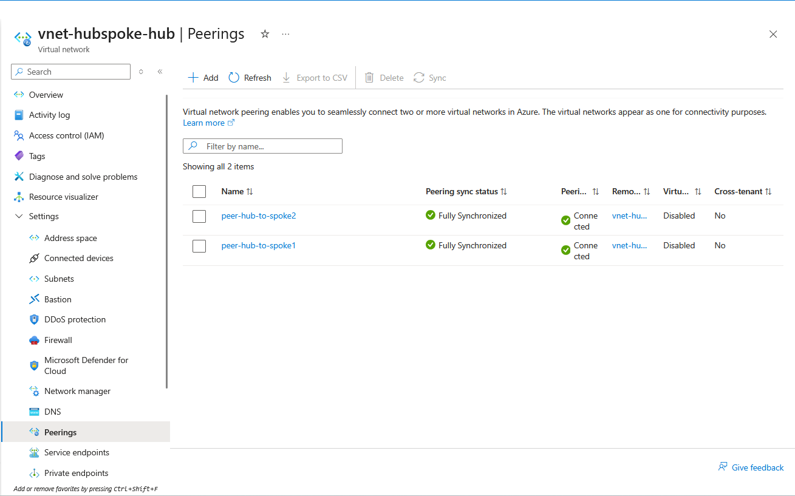 |
| UDR in effect | NIC effective routes | 0.0.0.0/0 to VirtualAppliance (firewall IP) | 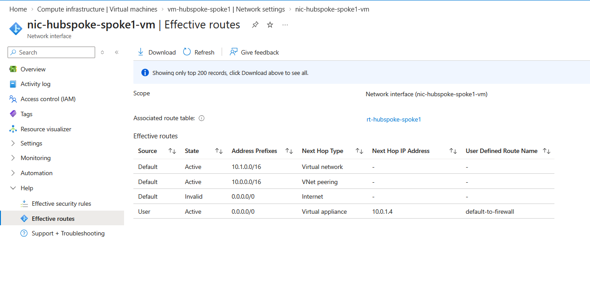 |
| Firewall policy and NSG rules | Portal | Rules as designed | 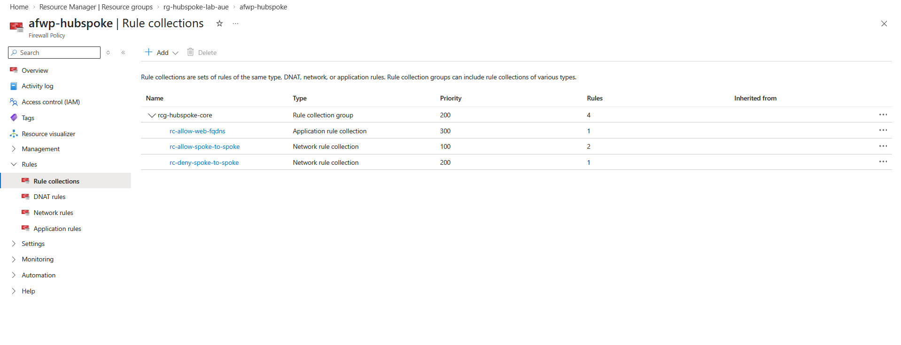 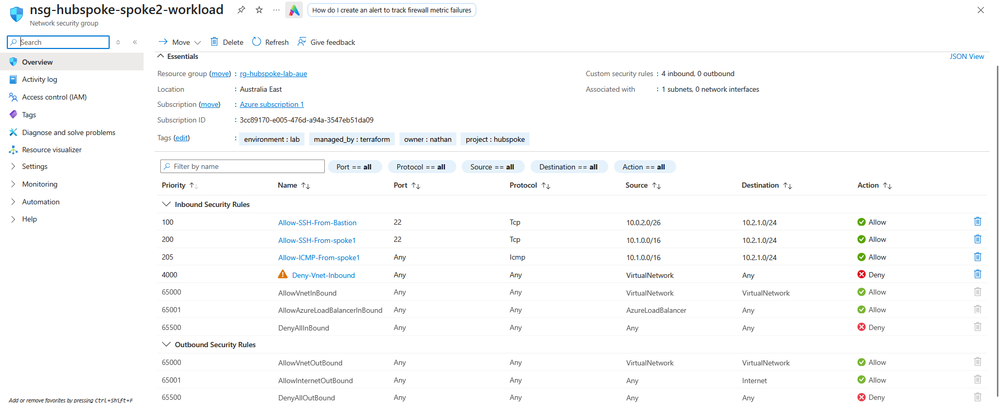 |
| Bastion access | Portal SSH with private key | Session on 10.1.1.4 | 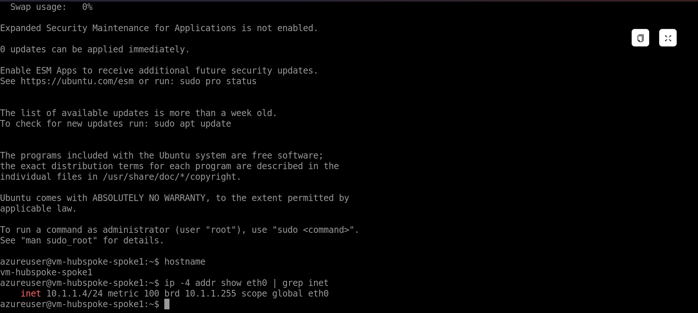 |
| Spoke1 to spoke2 | ping, nc port 22 | Success | 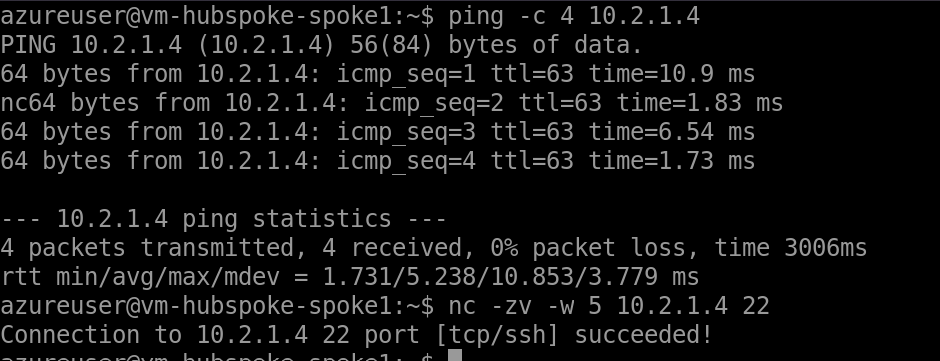 |
| Spoke2 to spoke1 | ping, nc port 22 | Blocked | 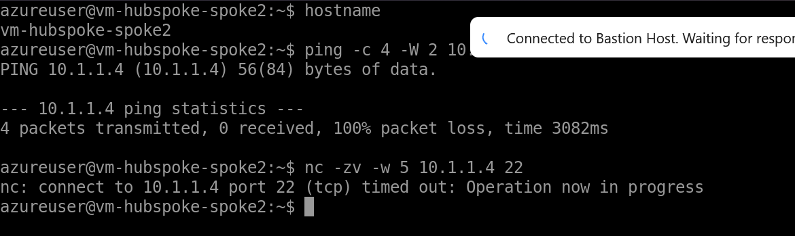 |
| Allowed FQDNs | curl, apt-get update | Success | 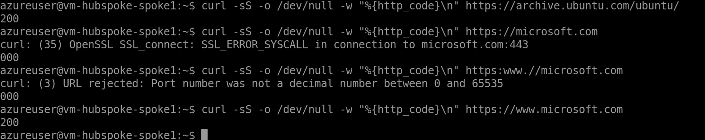 |
| Other sites and ICMP to internet | curl, ping | Blocked | 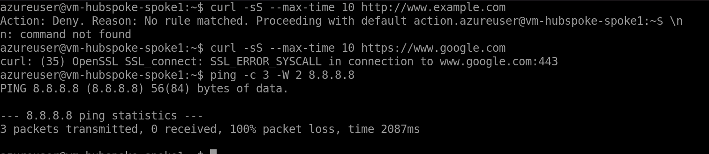 |
| Firewall logs (network rules) | KQL on AZFWNetworkRule | Allow and Deny entries with rule names | 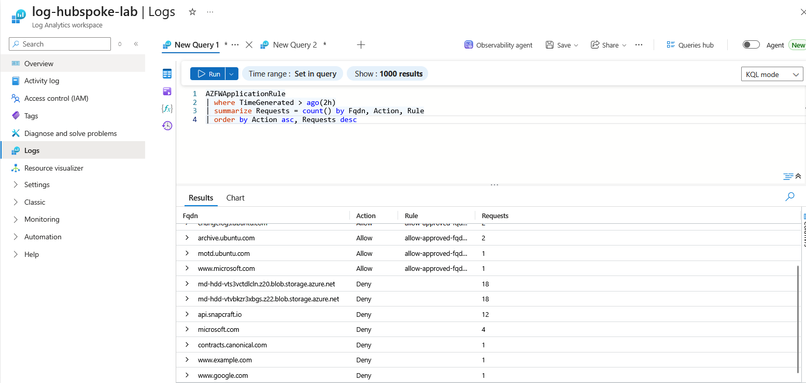 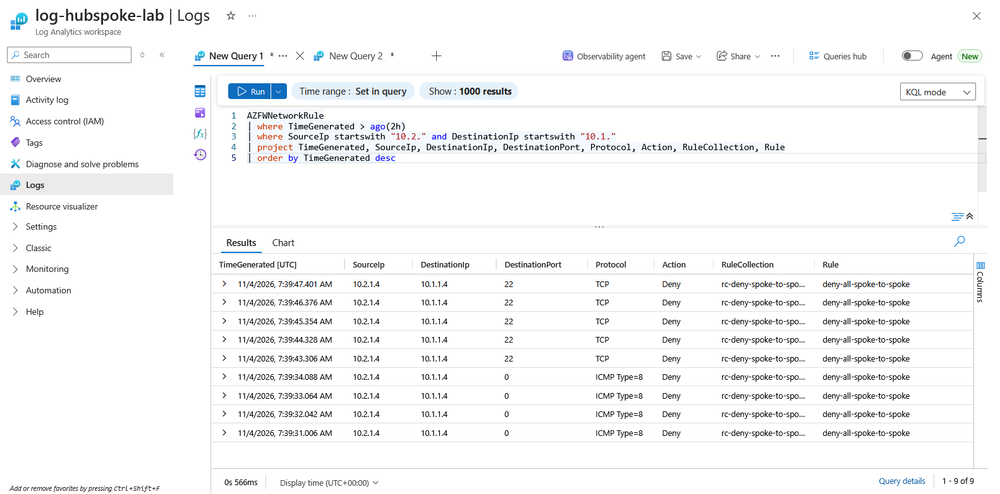 |
| Firewall logs (application rules) | KQL on AZFWApplicationRule | Allowed and denied FQDNs | 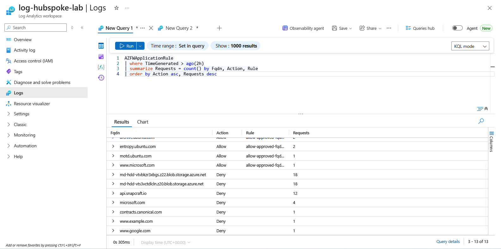 |
| Pipeline | GitHub Actions | Green plan on PR, green apply on main | 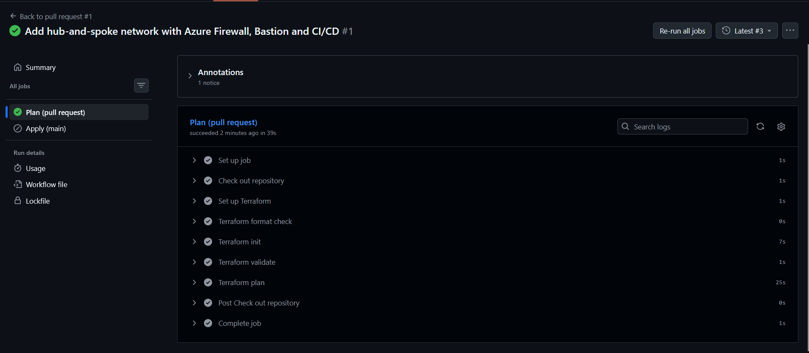 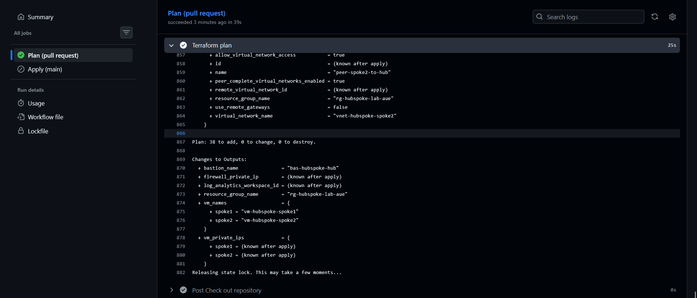 |
| State protection | Blob versions | Multiple state versions retained | 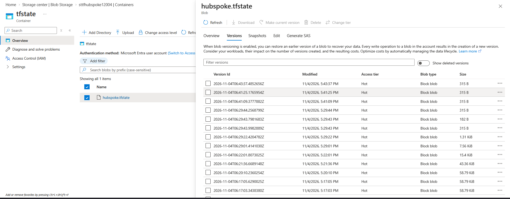

---

## Security considerations

- No VM has a public IP. Administrative access is only through Bastion, and NSGs only allow SSH from AzureBastionSubnet.
- Workload subnets have default outbound access disabled, so the firewall is the only egress path.
- Egress is restricted to approved FQDNs; everything else is denied and logged.
- Spoke-to-spoke traffic is allowed only in one direction, for two protocols, at both the firewall and the NSG layer.
- No secrets are stored in the repository or in GitHub. CI uses OIDC; the SSH public key is passed as an environment variable.
- Terraform state is only reachable with Entra ID identities that hold a data-plane role on that single storage account. Shared key access and public blob access are disabled, TLS 1.2 is enforced, and versioning plus soft delete allow recovery.
- Federated credentials are limited to this repository's main branch and its pull requests.
